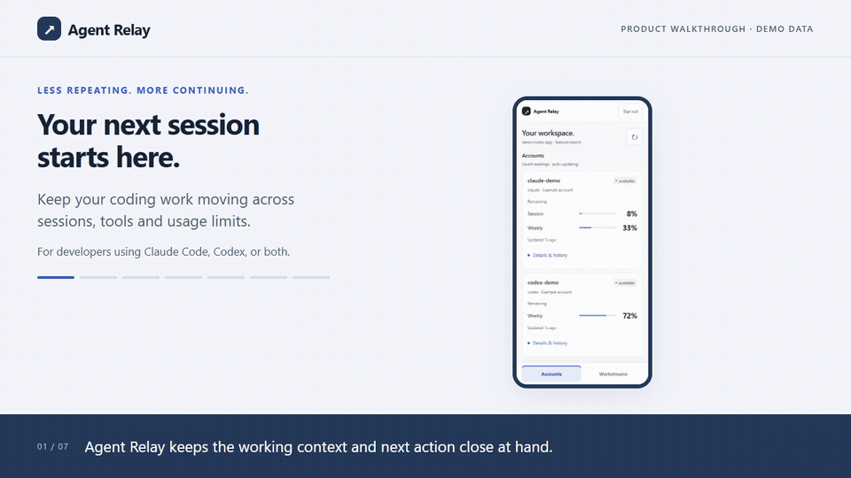
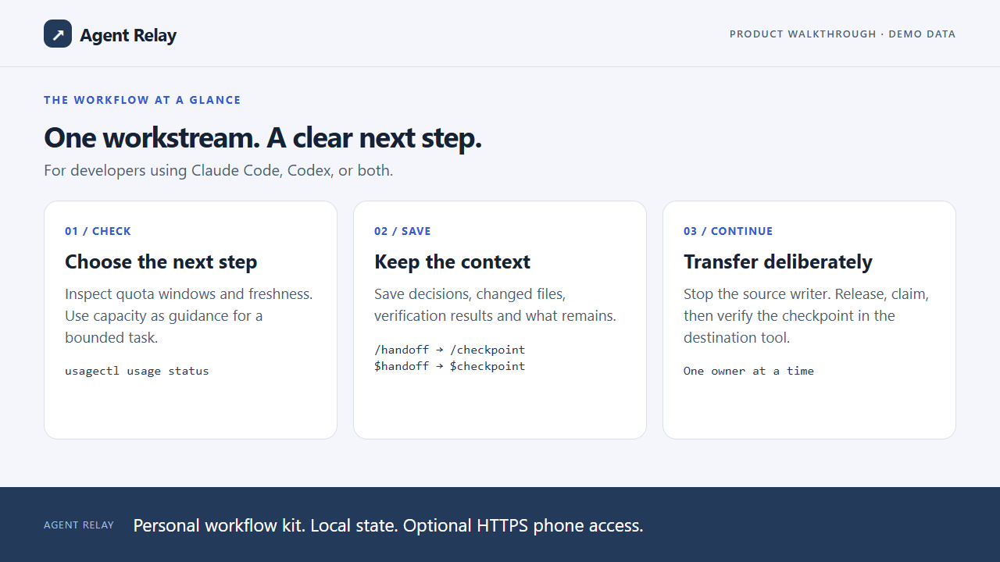

# Agent Relay

**Pick up your coding work without explaining it all again.**

For developers using **Claude Code, Codex, or both**. Relay saves your next step, shows recorded account capacity, and helps you hand work between sessions. It runs on your computer, alongside your existing Git projects.

## See it in 66 seconds



**[Watch / download the video](docs/media/agent-relay-walkthrough.mp4)** · [Text version](docs/demo/README.md#transcript)

The animation loops automatically. Silent, captioned walkthrough with real dashboard UI and simulated data. Use the MP4 for pause, seek and fullscreen playback, or read the text version above.

## Check → Save → Continue



| When this happens… | Relay helps you… |
|---|---|
| A fresh session loses the thread | Resume from saved decisions and a clear next step |
| You need to switch coding tools | Carry over a checkpoint with code state and verification |
| You're unsure which account has capacity | Check quota windows and how fresh the readings are |
| You're away from your desk | Check your workspace from a paired phone |

## Try it

You'll need Git, Bash (Git Bash on Windows), Python 3.9+, and the coding tools you want to use installed and signed in.

```bash
git clone https://github.com/prabhuashwin/agent-relay.git
cd agent-relay
bash install.sh --tool both --dry-run /path/to/your/project
bash install.sh --tool both /path/to/your/project
```

Replace the path with **your existing project**, then open a new tool session there. Choose `--tool claude` or `--tool codex` if you only use one tool.

Start with handoff notes. Add the dashboard and phone access when you need them:

- [Installation details](docs/setup-and-reference.md#quick-start)
- [Set up accounts and the dashboard](docs/setup-and-reference.md#usage-tracking-and-dashboard)
- [Connect your phone](docs/remote-access.md)
- [Walk through a Claude → Codex handoff](docs/setup-and-reference.md#example-continue-a-claude-task-in-codex)

## Know before you start

You still run the coding tools and review their work. Relay does not move chat history or increase usage limits. Readings can be stale or rate-limited; Claude account polling is experimental. Stop the source writer before handing off. Phone access is for one owner and their devices, and needs an awake, reachable host.

[Full setup and reference](docs/setup-and-reference.md) · [Daily workflow and recovery](GUIDE.md) · [Scope and limitations](docs/setup-and-reference.md#scope-and-limitations)

Also available as [claude-setup](https://github.com/ashwinp05/claude-setup). Installed paths retain that name for compatibility.
